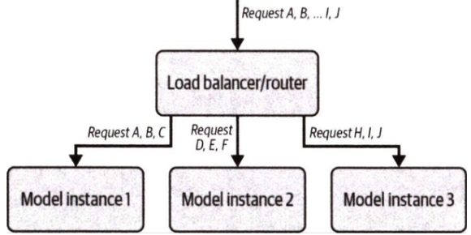
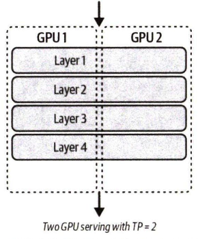
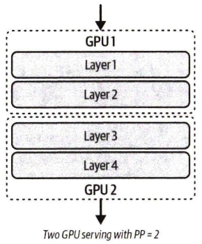
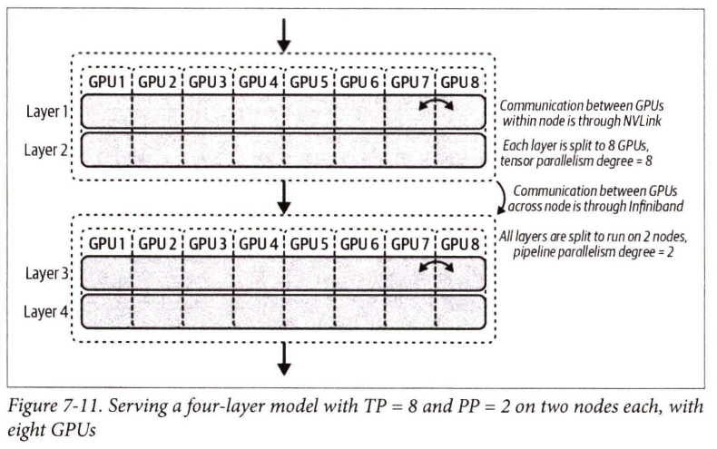
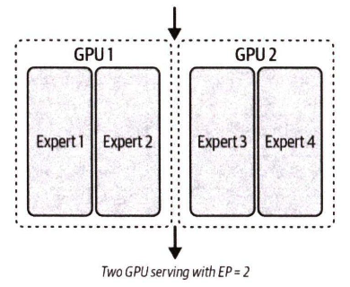
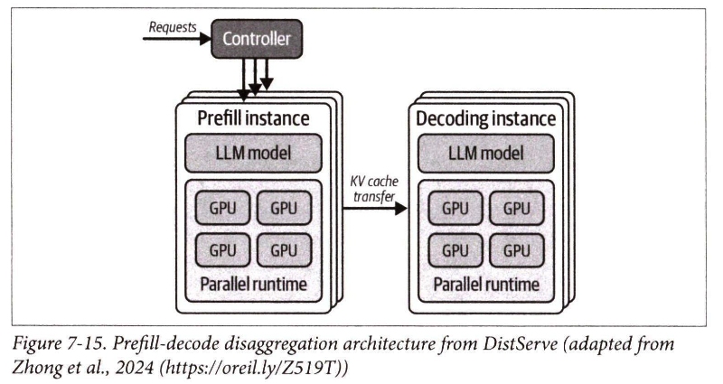
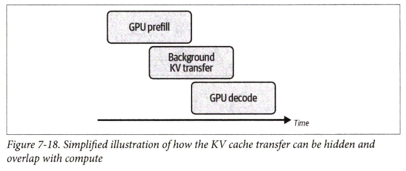

# 분산 서빙 기법 (Distributed Serving Methods)

## 1. 핵심 용어

| 용어 | 뜻 |
| --- | --- |
| 노드 (Node) | 서버 한 대 |
| 멀티 GPU (Multi-GPU) | 서버 한 대에서 GPU 여러 개 사용 |
| 멀티 노드 (Multi-node) | 서버 여러 대 사용, 서버마다 GPU가 하나 또는 여러 개 있을 수 있음 |
| 연산 성능 (FLOPS) | GPU가 초당 수행할 수 있는 부동소수점 연산 수 |
| 메모리 용량 (Memory Capacity) | 모델과 KV 캐시를 담을 수 있는 공간 |
| 메모리 대역폭 (Memory Bandwidth) | GPU 메모리에서 데이터를 읽고 쓰는 속도, H100 기준 약 3 TB/s |
| NVLink | 서버 내부 GPU끼리 빠르게 데이터를 주고받는 연결, 약 900 GB/s |
| PCIe | GPU 등을 연결하는 범용 인터페이스로, NVLink가 없는 환경의 GPU 간 통신에도 사용 |
| RDMA | CPU를 거치지 않고 다른 서버의 메모리를 직접 읽고 쓰는 기술 |
| InfiniBand | RDMA를 지원하는 서버 간 네트워크, 약 50–100 GB/s |
| 프리필 (Prefill) | 입력 전체를 한 번에 처리해 KV 캐시와 첫 토큰을 만드는 단계 |
| 디코드 (Decode) | KV 캐시를 사용해 출력 토큰을 하나씩 생성하는 단계 |
| KV Cache | 이전 토큰의 Key와 Value 값을 저장해 재사용하는 데이터 |
| TTFT | 요청 후 첫 토큰이 나올 때까지 걸리는 시간 |
| ITL | 출력 토큰 사이의 시간 간격 |

- 프리필은 연산 성능, 디코드는 메모리 대역폭이 속도를 결정 (3.1절 참고)
- GPU 간 연결은 GPU 메모리보다 느려서(NVLink 약 900 GB/s, GPU 메모리 약 3 TB/s), GPU를 두 배로 늘려도 성능은 두 배가 되지 않음
- GPU 수가 같아도 서버 여러 대에 나뉘면 느린 서버 간 네트워크로 통신하므로, GPU 한 개짜리 서버 여덟 대는 GPU 여덟 개 서버 한 대보다 느림

## 2. GPU 병렬화

### 2.1. 데이터 병렬화 (DP)

- 모델 전체를 올린 인스턴스를 여러 개 띄우고, 요청을 나누어 처리
- 인스턴스 수만큼 처리량이 늘고, 인스턴스 하나가 멈춰도 나머지가 요청을 받아 서비스 유지
- 로드 밸런서가 요청을 인스턴스에 분배하고, 멈춘 인스턴스로는 요청을 보내지 않음
- LLM 요청은 입력 길이와 처리 시간이 크게 달라서 분배 방식에 따라 성능 차이가 큼

| 분배 방식 | 동작 |
| --- | --- |
| 라운드 로빈 (Round Robin) | 정해진 순서대로 돌아가며 분배, 단순하지만 긴 요청이 한 인스턴스에 몰리면 부하 불균형 |
| 최소 연결 (Least Connections) | 처리 중인 요청 수가 가장 적은 인스턴스로 분배, 요청 수만 보고 각 요청의 길이는 반영하지 않음 |
| 지연 기반 (Latency-based) | 인스턴스별 응답 지연을 실시간으로 측정해 가장 빠른 곳으로 분배, 가장 느린 일부 요청의 지연(꼬리 지연) 감소 |
| 캐시 인지 (Cache-aware) | 앞부분(프리픽스)이 같은 요청을 그 KV 캐시를 이미 가진 인스턴스로 분배, 프리픽스 부분의 프리필을 생략해 TTFT 감소 |

- NVIDIA Dynamo KV Router나 llm-d 같은 LLM 라우터는 KV 캐시 적중률과 사용률, 입력 길이, 대기 요청 수, 지연 목표를 함께 보고 분배
- 모델이 GPU 한 개에 들어가지 않으면 TP나 PP로 묶은 GPU 그룹 하나를 인스턴스로 보고 복제

### 2.2. 텐서 병렬화 (TP)

- 각 레이어의 가중치 행렬을 쪼개 여러 GPU에 나누어 저장하고, GPU마다 자기 몫을 계산
- TP가 2이면 GPU 두 개가 모든 레이어를 절반씩 맡음
- 한 레이어를 여러 GPU가 동시에 계산하므로 큰 모델을 담으면서 지연도 감소
- 부분 결과를 합쳐야 다음 레이어로 넘어갈 수 있어서 레이어마다 GPU 간 통신 발생
- 통신이 잦으므로 NVLink로 연결된 서버 내부 GPU에 적합

### 2.3. 파이프라인 병렬화 (PP)

- 모델을 깊이 방향으로 잘라, 연속된 레이어 묶음(단계)을 GPU마다 맡김
- 앞 단계 GPU의 출력을 다음 단계 GPU가 이어받아 계산
- PP가 2이면 레이어 1과 2는 GPU 1, 레이어 3과 4는 GPU 2가 처리
- 단계가 바뀔 때만 통신하므로 TP보다 통신이 훨씬 적고, 느린 서버 간 연결에 유리
- 느린 단계가 생기면 나머지 GPU가 기다리는 파이프라인 버블이 발생해 GPU 활용률 저하
- 예를 들어 레이어 2가 느리면 GPU 1은 계속 바쁘지만 GPU 2는 대부분의 시간을 대기

### 2.4. 하이퍼스케일 (Hyperscale)

- 모델이 GPU 여덟 개짜리 서버 한 대에도 들어가지 않을 때 쓰는 구성
- 서버 내부는 TP, 서버 사이는 PP로 나눔
- 레이어마다 통신하는 TP는 빠른 NVLink 안에서 처리하고, 느린 서버 간 InfiniBand는 PP 단계 경계에서만 사용
- 그림은 TP 8, PP 2 구성으로, GPU 여덟 개짜리 서버 두 대가 각각 레이어 1과 2, 레이어 3과 4를 담당
- 서버 간 통신 비용과 파이프라인 버블이 남으므로 꼭 필요할 때만 사용
- vLLM은 `--tensor-parallel-size`와 `--pipeline-parallel-size`로 설정하고, 여러 서버에 걸친 실행은 Ray 사용

### 2.5. 전문가 병렬화 (EP)

- MoE 모델은 레이어 안에 여러 전문가 네트워크를 두고, 라우터가 토큰마다 일부 전문가만 골라 계산 (예: Mixtral 8x7B, DeepSeek-V3, GPT-OSS)
- 계산은 일부 전문가만 하지만 모든 전문가의 가중치를 메모리에 올려야 해서 GPU 한 개에 담기 어려움
- EP는 전문가를 여러 GPU에 고르게 나누어 배치
- 토큰은 선택된 전문가가 있는 GPU로만 전달되고, 선택되지 않은 전문가는 계산하지 않음
- TP나 PP와 함께 사용

### 2.6. 선택 기준

## 3. 입력 처리와 생성 분리 (PD)

### 3.1. 프리필과 디코드의 병목

| 구분 | 프리필 | 디코드 |
| --- | --- | --- |
| 처리 방식 | 입력 토큰 전체를 한 번에 병렬 처리 | 출력 토큰을 하나씩 순서대로 생성 |
| 병목 | 연산 성능, 큰 행렬끼리 곱하므로 계산량이 많음 | 메모리 대역폭, 토큰 하나를 만들 때마다 가중치와 KV 캐시를 메모리에서 다시 읽음 |
| 영향을 받는 지표 | TTFT | ITL |
| 최적화 목표 | GPU 연산 유닛(텐서 코어)을 쉬지 않게 채워 TTFT 단축 | 메모리에서 읽은 데이터로 최대한 많이 계산해 ITL 목표 안에서 처리량 증가 |
| 배치 크기 | 행렬이 텐서 코어를 가득 채울 만큼 커지도록 입력 길이에 맞춰 조정 | 한 번 읽은 가중치로 여러 요청을 함께 계산할 만큼 키우되, ITL 목표를 넘지 않게 조정 |
| GPU 선택 | 비용 대비 FLOPS가 높은 GPU | 메모리 용량과 대역폭이 큰 GPU |

- 프리필은 입력이 길수록 계산량이 늘어 TTFT가 길어지므로, 연산 성능을 확보하는 것이 핵심
- 디코드는 계산보다 메모리 읽기가 오래 걸리므로, 배치를 키워 한 번 읽은 데이터를 여러 요청에 재사용하는 것이 핵심
- 디코드 배치가 너무 크면 토큰 하나를 만드는 데 걸리는 시간이 늘어 ITL이 나빠짐
- 디코드는 TP를 높여 여러 GPU의 메모리 대역폭을 합쳐 쓰는 방법도 사용

### 3.2. 분리 효과

- 통합 서빙에서는 같은 GPU가 두 단계를 번갈아 처리하므로, 긴 프리필이 들어오면 진행 중인 디코드가 기다려 ITL 증가
- 청크 단위 프리필은 긴 입력을 나누어 처리해 디코드의 대기를 줄이지만, GPU 한 대를 두 병목에 동시에 맞출 수는 없음
- 분리하면 3.1절의 배치 크기, GPU 종류, 병렬화 구성을 단계마다 따로 적용
- 입력이 길고 출력이 짧은 서비스는 TTFT가 중요하므로 프리필 자원을 늘림
- 입력이 짧고 출력이 긴 서비스(추론 모델 등)는 ITL이 중요하므로 디코드 자원을 늘림
- 디코드가 프리필과 GPU를 공유하지 않으므로 ITL이 안정됨
- 프리필은 요청이 몰릴 때 부하가 튀므로 빠르게 증설하고, 디코드는 부하가 꾸준해서 안정적으로 운영

### 3.3. 구조

- 컨트롤러가 요청을 프리필 그룹에 보내고, 프리필 그룹은 만든 KV 캐시를 디코드 그룹으로 전달
- 디코드 그룹은 입력을 다시 처리하지 않고 받은 캐시로 토큰 생성
- 두 그룹은 같은 모델을 각각 보유하며, 그룹마다 TP나 PP를 다르게 적용 가능

### 3.4. KV 캐시 전송

- 전송이 느리면 분리로 얻은 이득이 사라지므로, PD 분리의 성패는 KV 캐시 전송 속도에 달림
- 전송량은 입력 길이와 초당 요청 수에 비례
- 80억 파라미터 모델은 입력 1,024 토큰당 KV 캐시가 약 0.1–0.15 GB이고, 입력이 약 1만 토큰이고 초당 16개 요청이면 초당 약 25 GB 전송

| 연결 | 대역폭 | 초당 25 GB 전송 |
| --- | --- | --- |
| 서버 내부 NVLink | 900 GB/s 이상 | 충분 |
| 서버 간 InfiniBand (RDMA) | 50–100 GB/s | 가능 |
| 서버 간 PCIe (RDMA 없음) | 약 10 GB/s | 부족 |

- 두 그룹을 같은 서버에 두면 NVLink로 빠르게 전송하지만, 같은 GPU 종류를 써야 하고 그룹 크기도 서버 한 대로 제한됨
- 프리필 그룹에만 GPU 여덟 개 TP가 필요한 경우처럼 서버를 나눠야 하면 RDMA 필수
- 계산이 끝난 레이어의 캐시부터 백그라운드로 전송해, 프리필 계산과 전송을 겹침
- 블록 크기 조정과 캐시 압축으로 전송 효율 개선
- 이런 최적화로 PD 분리의 오버헤드를 요청 지연의 1% 미만으로 줄일 수 있음

### 3.5. 적용 기준

